# User guide

BerremanCalculator evaluates a stack of layers: plane waves through homogeneous planar layers of
any material, between any two outer media. It computes reflection, transmission and absorption,
the Jones coefficients, Ψ and Δ, the Mueller matrices, the absorption in each layer and the
fields against depth. From those it draws spectra, Mueller-matrix panels, conoscopic maps and
field profiles. It never changes the stack: it evaluates, and ThinFilmDesigner, which shares its
design files, optimises.

The engine itself is a native library that other programs can call. The examples
[examples/zemax-uds](../examples/zemax-uds/README.md) and
[examples/optiland](../examples/optiland/README.md) use it inside OpticStudio and Optiland, to put an
anisotropic film on a lens surface in a polarization ray trace.

A stack is described by a **stack file**, a JSON document ([the format](stack-format.md)). All
three programs read the same file:

| Program | For |
|---|---|
| `berreman-gui` | Editing a stack, evaluating it, and plotting the results |
| `berreman` | Scripts: evaluate a file, print or write a table, convert, import a coating, report |
| `berreman-mcp` | An AI assistant: evaluation, samples, materials, analyses and conversion as tools |

The samples from the literature are installed beside the programs, under `samples/`. Each one
names the paper it reproduces. [samples/README.md](../samples/README.md) says how closely each is
reproduced.

## Getting started

This chapter walks through the program with a sample from the literature: Mansuripur's
magneto-optic quadrilayer (*J. Appl. Phys.* **67**, 6466 (1990)). The pictures are taken from the
program itself (see [Pictures](#pictures) at the end of this chapter).

### The window

The program opens with a new stack: air, one 100 nm layer of index 1.38, and glass. It evaluates
it straight away.

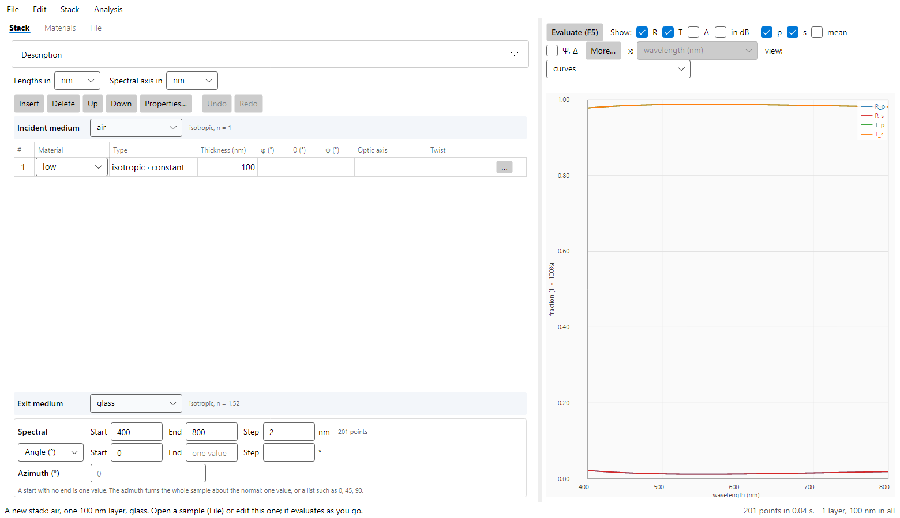

- **Left: the stack.** The tabs are *Stack* (the layers, the outer media and the sweep), *Materials*
  (what each material is) and *File* (the stack file as text).
- **Right: the results.** Tick what to plot (R, T, A, the two incident waves, Ψ and Δ), choose the
  x axis and the view, and press **Evaluate (F5)**. With *Analysis > Evaluate after every change*
  (on by default), every edit is evaluated as you make it.
- **Bottom: the status line.** It says what just happened, or why a value was refused. On the right
  it gives the number of points, the time taken, and the layers and total thickness.

The two incident waves are **p** and **s** when the incident and exit media are both isotropic.
When either is anisotropic, the waves are that medium's own two modes, which in general are neither
p nor s, and the boxes and the curves say **mode 0** and **mode 1** instead (R_0, R_1, and so on).
Mode 0 is the more p-like of the two.

### Opening a sample

**File > Browse samples…** lists the samples. Type in the box to search their titles, sources and
notes. Each one shows its source and its notes: what the paper gives, and anything it leaves out.

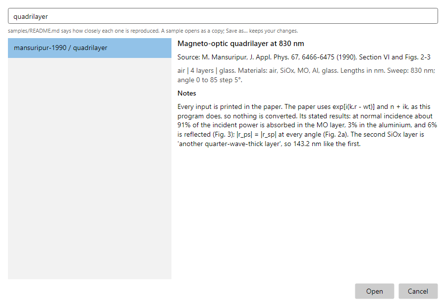

**Open** opens a copy, so the sample itself is never changed. Save as… keeps your copy.

### Evaluating

The quadrilayer is SiOx, a 20 nm magneto-optic (MO) layer, SiOx and aluminium, on glass, at
830 nm, for angles of incidence from 0° to 85°. Its sweep is one wavelength and many angles, so
the x axis is the angle of incidence.

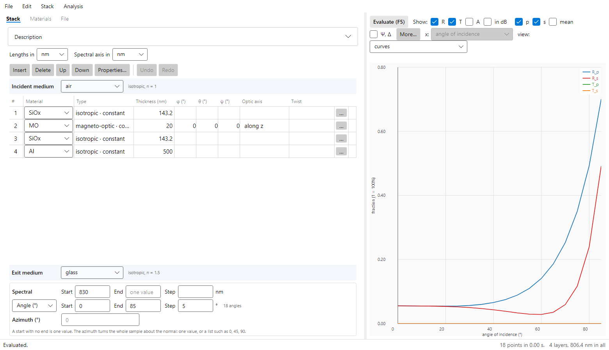

R_p (blue) and R_s (red) are reflectances. T is zero: 500 nm of aluminium lets nothing through.

### Choosing what to plot

R, T, A, Ψ and Δ have boxes of their own. Everything else is under **More…**: the reflection and
transmission powers and amplitudes, the phases, the cross-polarised terms and the Mueller
elements. Hover over a name to see what it is.

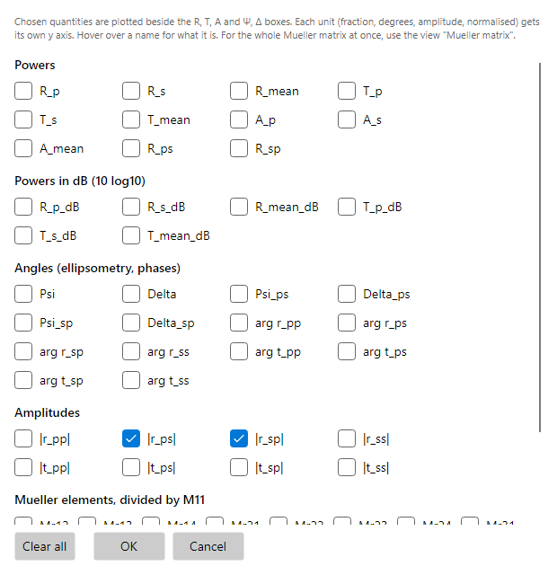

The MO layer converts some of an incident p wave into s, and s into p. |r_ps| is the amplitude of
the s wave reflected from a p wave of amplitude 1, and |r_sp| the other way round. Here R and T
are unticked, so the plot shows only the conversion:

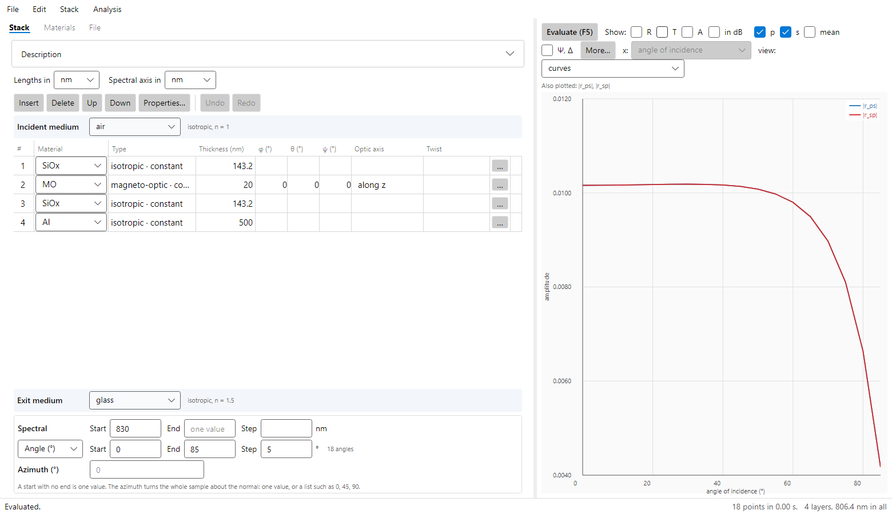

### Turning a layer

The table has three angles for each anisotropic layer, φ, θ and ψ. They turn the material from
its own axes into the stack's. Isotropic layers have none, since turning them changes nothing. The
*Optic axis* column says where the material's own z axis ends up. For the MO layer, that is the
direction of the magnetization.

Typing φ = 20°, θ = 39°, ψ = 30° into the MO layer's row tilts its magnetization 39° from the
normal:

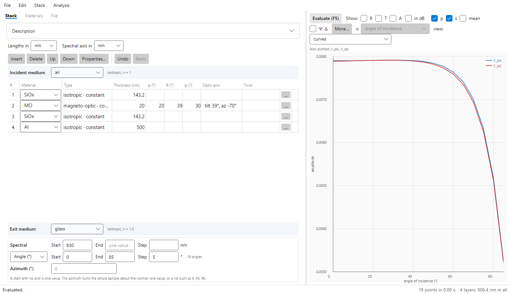

**What to expect.** The tilt hardly changes R; the change is in the conversion:

| At normal incidence | Not tilted | Tilted 39° |
|---|---|---|
| R_p | 0.05527 | 0.05523 |
| \|r_ps\| | 0.01016 | 0.00790 |

- **Why R hardly moves.** The MO layer's ε has −4.90 + 19.4i on its diagonal and only about 0.43
  off it. R, T and A come almost entirely from the diagonal, which is the same along every axis,
  so turning the layer leaves it unchanged. Only the small off-diagonal part turns. That part is
  the magneto-optic effect, and it shows in r_ps and r_sp, the Kerr effect.
- **Why |r_ps| falls by cos 39°.** At normal incidence only the component of the magnetization
  along the normal acts (the polar Kerr effect): 0.01016 × cos 39° = 0.00790.
- **Why |r_ps| and |r_sp| part.** At oblique incidence the in-plane part of the tilted
  magnetization adds the longitudinal and transverse effects, which act differently on p and s.

**Some angles change nothing, correctly.** This material's only special direction is its
magnetization, its own z axis:
- **ψ** turns the material about that axis, so it changes nothing here;
- **φ with θ = 0** turns it about the normal, which also changes nothing at normal incidence.

Only θ, the tilt, changes the results here. A material with three different principal indices
(biaxial) responds to all three angles.

**Properties…** (or the … button at the end of the row) shows the same angles, with a second way
to set them: give the direction of the optic axis, as a tilt from the normal and an azimuth, and
**Set the angles** fills in φ and θ. It also sets a twist, for a cholesteric.

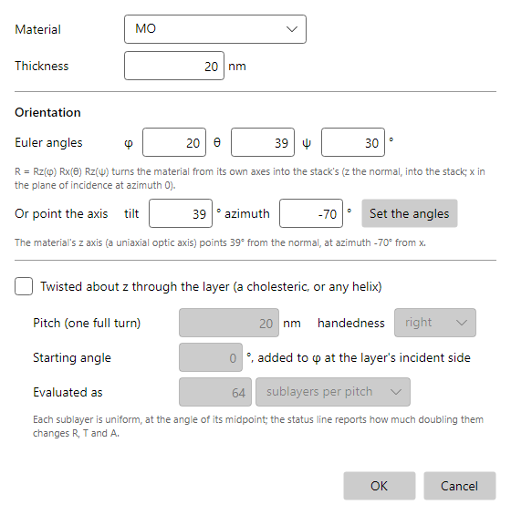

### Materials

The **Materials** tab lists the stack's materials, each with a summary, and edits the one selected.
In the new stack, the layer's material is `low`, a constant index of 1.38:

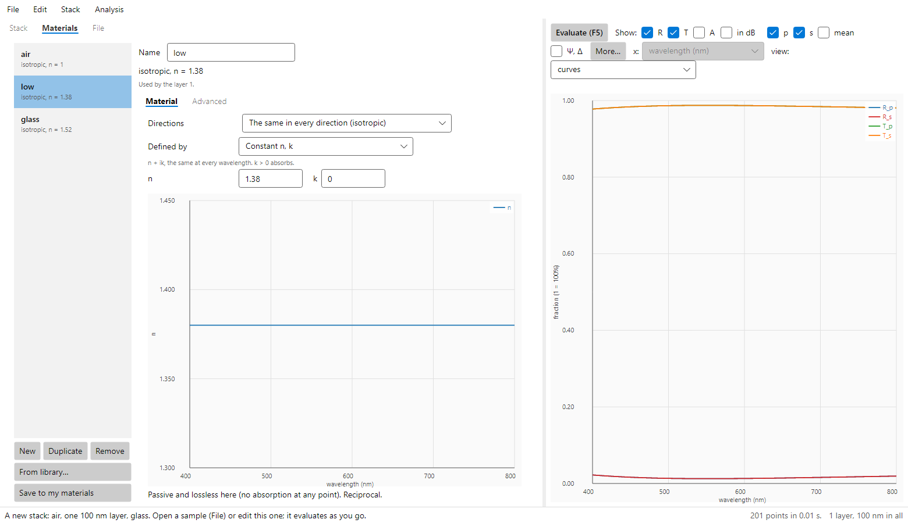

- **Name** renames the material everywhere it is used. Under it, the tab says where that is
  ("Used by the layer 1").
- **Directions** says whether the index is the same in every direction (isotropic), ordinary and
  extraordinary (uniaxial), or different along x, y and z (biaxial).
- **Defined by** says how each index varies with wavelength: a constant, a catalogue glass, a
  Sellmeier or Cauchy formula, a table of measured values, a Tauc–Lorentz law, or phonons.
- **The plot** shows n (and k, where it is not zero) over the stack's spectral range. Under it, the
  tab says whether the material is passive and reciprocal.

### Adding a material from a library

**From library…** offers ThinFilmDesigner's material databases, five vendors' glass catalogues and
your own saved materials. Choose a library, type to search it, and select one or several entries.
Below the list is each entry's source and its index at the stack's first wavelength.

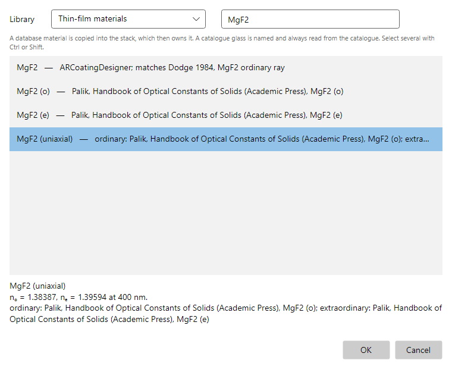

A crystal listed in the database as an ordinary (o) and an extraordinary (e) material is also
offered as one uniaxial material: here **MgF2 (uniaxial)**, from Palik's two tables. A database
material is copied into the stack. A catalogue glass is not copied: the stack names it, and its
index is always read from the catalogue.

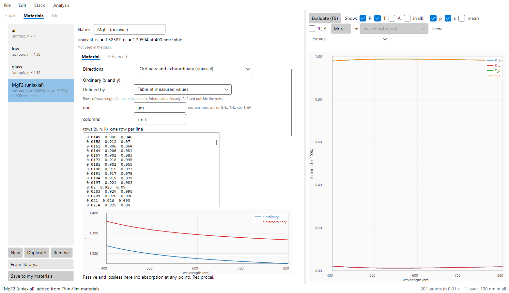

### Using a crystal in a layer

On the Stack tab, the layer's **Material** box now offers MgF2. Choose it, and the *Type* column says
"uniaxial · table". The angles φ, θ and ψ appear, because turning a crystal changes it. With
θ = 60°, the optic axis tilts 60° from the normal; with φ = 0°, its azimuth is −90°, so it lies in
the y–z plane:

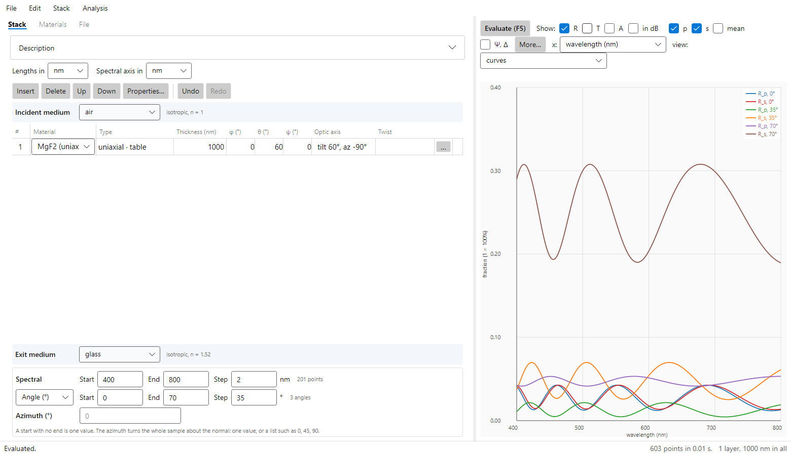

The tilted axis makes p and s different even at normal incidence. A wave polarized along x (p)
sees only the ordinary index. One polarized along y (s) has a component along the tilted axis, so
it sees an index between the ordinary and the extraordinary. With an untilted axis (θ = 0) the two
would be equal at normal incidence.

### A crystal with turning axes: Ga₂O₃

Some materials are more than an index per direction. The sample *schubert-2016 / ga2o3-010* is
monoclinic β-Ga₂O₃, written as **terms** ([material-model.md](material-model.md)): a background ε,
and oscillators, each along its own direction. The Material page says what it is, and
**Advanced › Terms** lists the terms and edits each one: its law (here a Lorentz oscillator, with
its amplitude, centre and damping) and its shape (here a direction in the crystal's a–c plane).

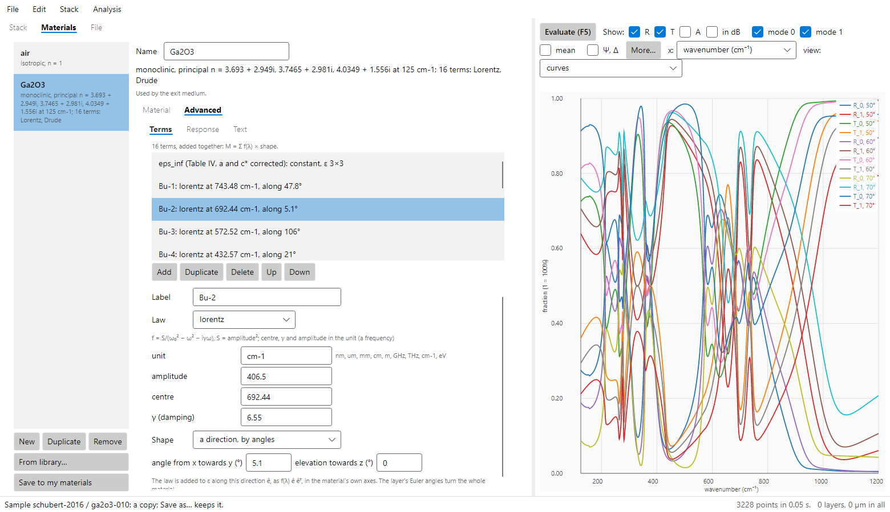

**Advanced › Response** plots the material over any range: n and k along its principal axes, any
element of its 6×6 matrix, or the directions of its principal axes. Ga₂O₃ shows why the terms are
needed. One principal axis stays along z (the crystal's b axis, normal to this (010) surface). The
other two lie in the a–c plane (tilt 90°) and turn as the wavenumber changes. The oscillators lie
along different directions in that plane, and near its resonance each one dominates ε, so the axes
follow. In a crystal of higher symmetry the axes are fixed by the symmetry.

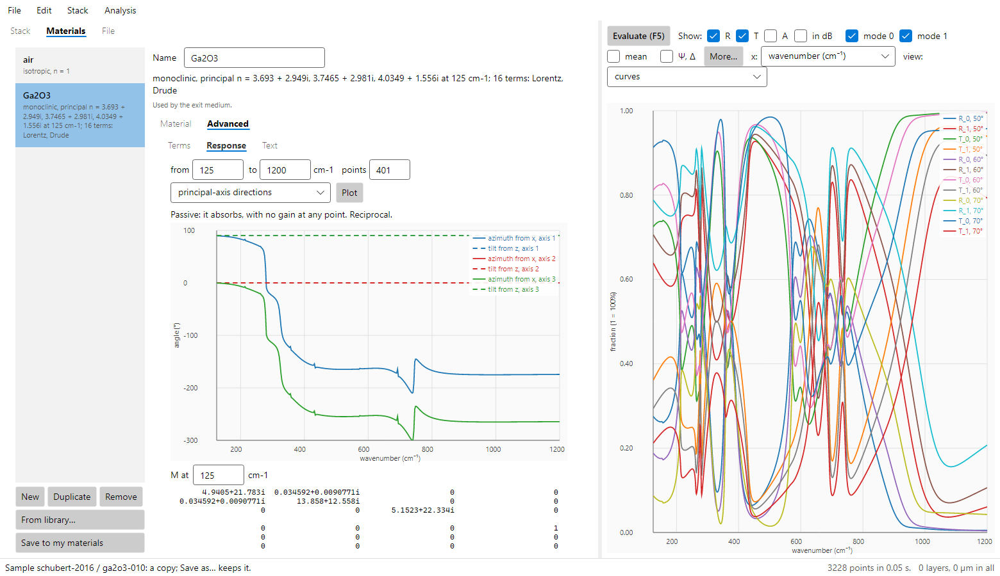

Each axis is followed from point to point, so an azimuth can run past ±180°. An axis is a line, so
−260° and 100° are the same direction. Under the plot, M at one wavenumber is printed in full.

### A twisted layer: a cholesteric

The sample *ting-2006 / cholesteric-fig2* is a cholesteric liquid crystal (Ting et al., *Opt.
Express* 14, 5594 (2006)): a uniaxial layer, nₒ = 1.494 and nₑ = 1.616, whose optic axis lies in the
plane of the layer and turns about the normal, one full turn per 338 nm, through 12 turns (4056 nm).
The outer media have the mean index, 1.555, so that only the helix reflects.

Here only R is ticked, and **mean**, the unpolarised reflectance (the mean of the two incident
waves):

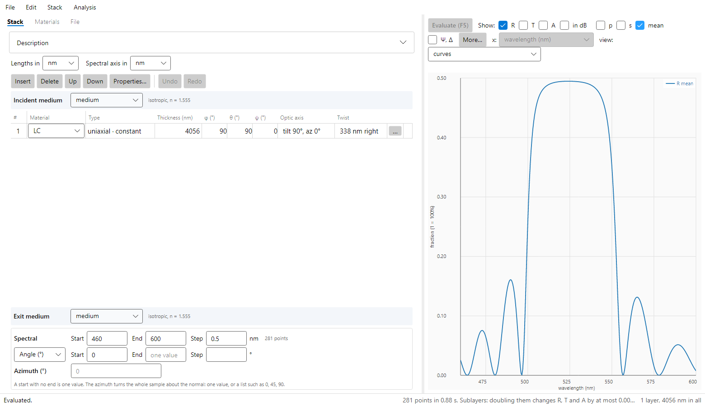

The band lies between nₒP = 505.0 nm and nₑP = 546.2 nm. Its top is about 0.5 (0.495), because a
cholesteric reflects only the circular polarization of its own handedness and passes the other.
The *Twist* column says "338 nm right", and **Properties…** shows the twist:

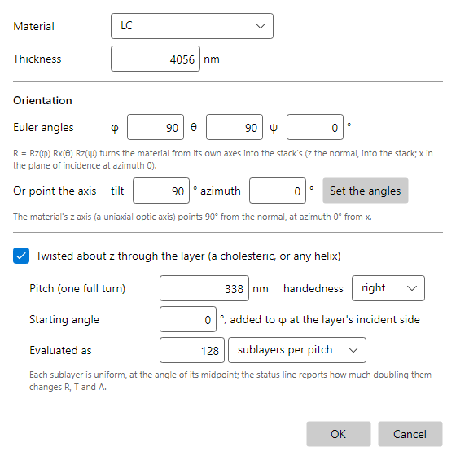

- **Pitch** is one full turn, and **handedness** its sense.
- **Starting angle** is added to φ at the layer's incident side.
- **Evaluated as** says how finely the helix is cut: each sublayer is uniform, at the angle of its
  midpoint. Here 128 per pitch. The status line reports how much doubling them changes R, T and A,
  so you can tell whether the cut is fine enough.

### Microwaves and dB

The program works the same at any wavelength, so a microwave radome wall is a stack like any other.
The sample *anshin-2024 / sandwich-radome* is a three-layer wall (two 1.8 mm fibreglass skins and a
6.9 mm foam core, Anshin et al., RMC 2024). Its lengths are in mm and its spectral axis in GHz,
both chosen under *Lengths in* and *Spectral axis in*. Microwave engineers read transmission in
decibels, so here only T and s are ticked, with **in dB**:

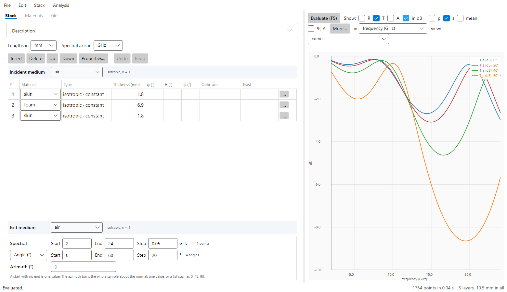

At 60° the s wave loses up to 8.65 dB, at 19.5 GHz; at normal incidence it loses at most 2.98 dB,
at 24 GHz. The same values are quantities of their own, R_p_dB, T_s_dB,
T_mean_dB and so on, for **More…**, the command line (`berreman evaluate wall.berr --quantities
T_p_dB,T_s_dB`) and the MCP server.

### The Mueller matrix

**view: Mueller matrix, reflection** (or transmission) shows all sixteen elements at once, each
divided by M11. M11 itself is the unpolarised reflectance. Here is Ga₂O₃ again, at 50°, 60° and 70°:

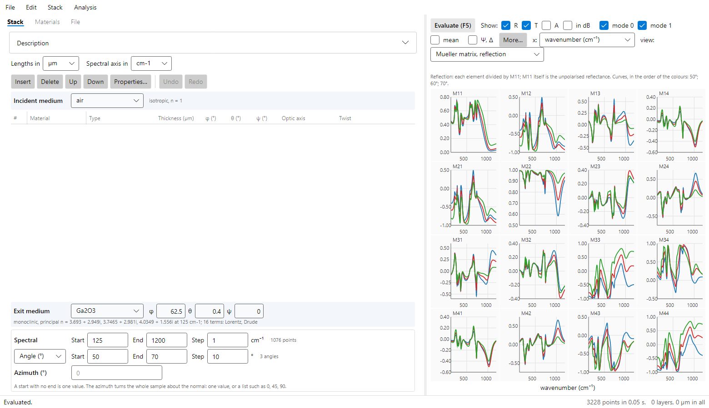

An isotropic sample has only the two diagonal blocks (M12, M21, M22 and M33, M34, M43, M44). Everything in the
off-diagonal blocks (M13, M14, M23, M24, M31, M32, M41, M42) is polarization conversion by the
crystal. That is what generalized ellipsometry measures, and it is why Schubert's paper plots
these elements. A single element can also be plotted with the others under **More…**.

### Conoscopic maps

**Analysis › Conoscopic map…** evaluates one wavelength over every direction of incidence and draws
a quantity as a map. The radius is the angle of incidence, and the polar angle the sample's azimuth.
Here a uniaxial plate cut across its optic axis (nₒ = 1.5, nₑ = 1.6, 60 µm, in oil of index 1.55) is
seen between crossed polarizers at 600 nm, the classic conoscopic figure:

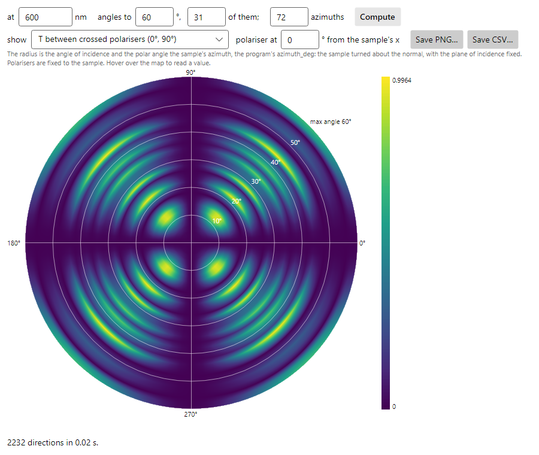

- **The dark cross** lies along the polarizer and the analyser. A wave polarized along either sees
  no change of polarization, so the analyser stops it.
- **The rings** are where the retardance between the ordinary and extraordinary waves is a whole
  number of waves. It grows with the angle of incidence, so the rings crowd outwards.
- **The centre** is dark: along the optic axis there is no birefringence.

Choose the wavelength, the largest angle, the number of angles and azimuths, and **Compute**. The
**show** list then changes the quantity without computing again: crossed or parallel polarizers
(their angle under **polariser at**), or any quantity of **More…**. Hover over the map to read a
value. **Save PNG…** and **Save CSV…** keep the map.

### Field profile

**Analysis › Field profile…** computes the fields against depth through the stack at one wavelength,
angle and azimuth: |E|², its x, y and z parts, |H|², or Re E. Here is the quadrilayer at 830 nm and
normal incidence. Depth runs from the first interface, and the dashed lines are the interfaces:

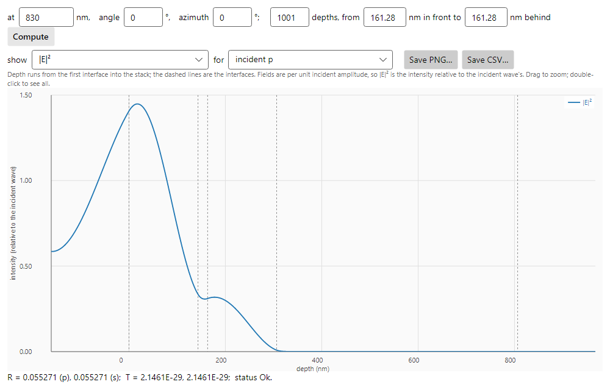

- **In front** (negative depth), the incident and reflected waves make a standing wave.
- **In the stack,** |E|² is largest in the first SiOx layer, about 1.45. In the 20 nm MO layer
  (from 143 to 163 nm) it is about a third of the incident wave's.
- **In the aluminium** (from 306 nm), it falls to nothing within a few tens of nanometres.

The fields are per unit incident amplitude, so |E|² = 1 is the incident wave's intensity. The same
window shows the **index profile**, n and k along x, y and z through the stack, which is a quick
check of what the light meets:

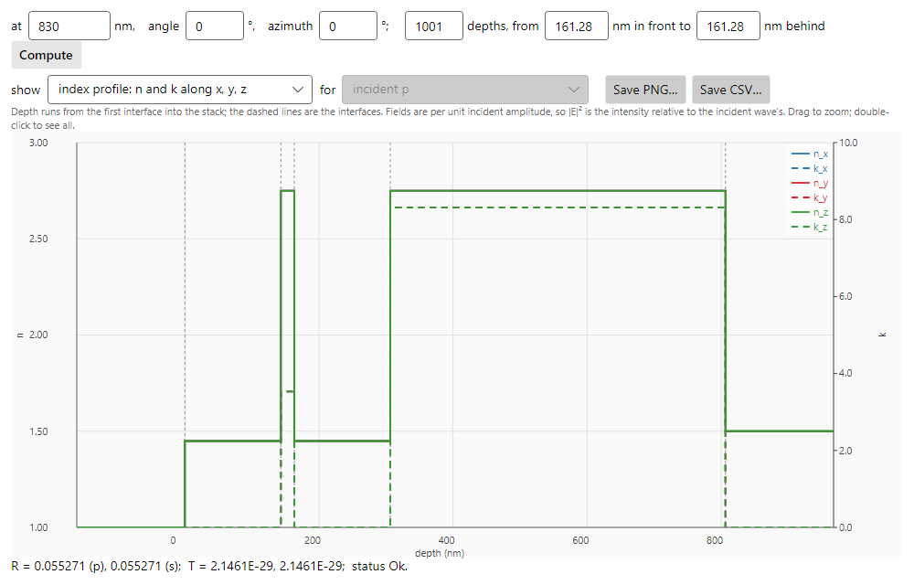

### The stack as a file

The **File** tab shows the stack exactly as it is saved (a JSON document, [the format](stack-format.md)).
Edit it there if you prefer text: the change takes effect when you leave the text, and one Undo
takes it back. An edit made in the tables shows here at once.

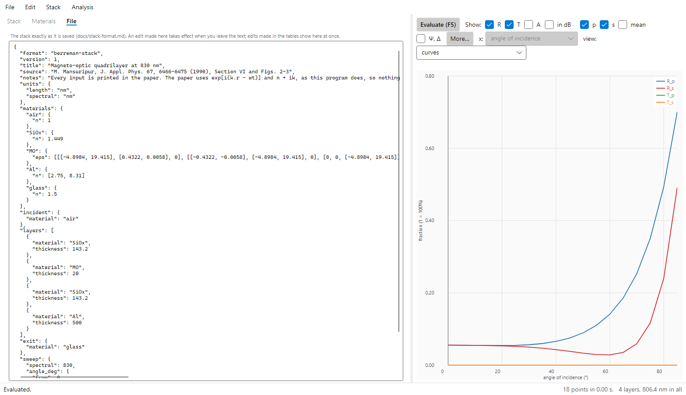

**File › Save** (Ctrl+S) and **Save as…** write it as a `.berr` file, and **Open…** reads one back.
**File › Export** writes the results as CSV, the plot as PNG, or a design report: the layers in
physical units, and every material as a table over the sweep.

### Importing a coating

**File › Import a coating from OpticStudio or Optiland…** reads an OpticStudio coating file (such as
COATING.DAT), an Optiland coating file, or an Optiland lens file, and lists its coatings:

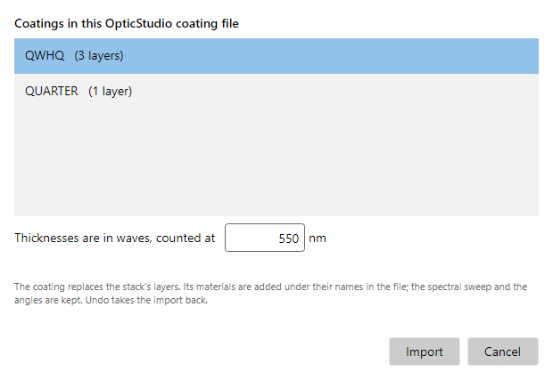

OpticStudio gives thicknesses in waves (optical thickness) or in micrometres. For waves, the dialog
asks at which wavelength to count them, offering the sweep's first. **Import** replaces the
stack's layers with the coating's, in physical thicknesses. The coating's materials are added under
their names, and the sweep is kept:

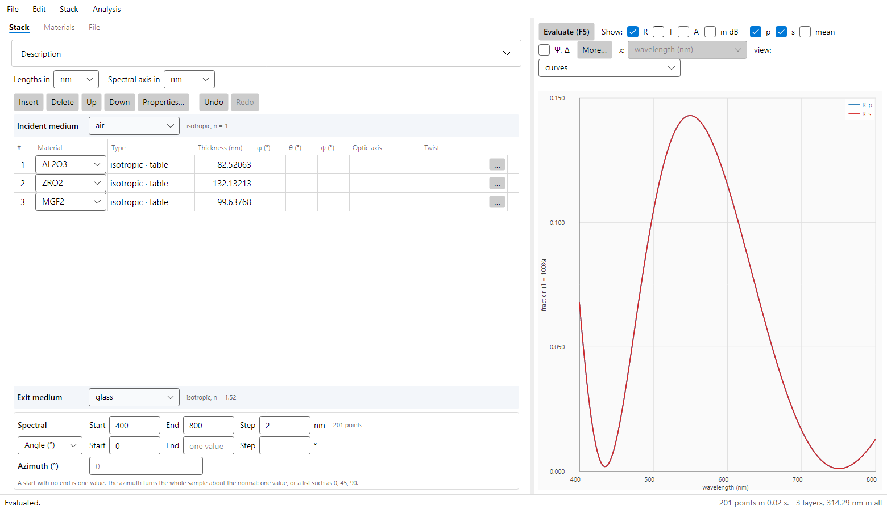

A quarter wave of Al₂O₃ (n = 1.666 at 550 nm) is 0.25 × 550 / 1.666 = 82.52 nm, as in the table.
Once imported, a coating is a stack like any other: its layers can be made anisotropic, oriented
and analysed. **File › Import a ThinFilmDesigner design (.tfd)…** does the same for a design from
ThinFilmDesigner.

### Pictures

The pictures in this guide are taken from the program itself, headless, by
`dotnet run --project managed/Berreman.Gui.Tests -c Release -- --guide docs/images`. Each one is
taken after driving the window as a person would, so they can be taken again whenever the window
changes.

## The GUI

The window shows the stack being edited on the left and its results on the right. Every change
is evaluated as you make it (**Analysis > Evaluate after every change**, on by default); **F5**
evaluates on demand. Every edit, on any tab, can be undone with Edit > Undo (**Ctrl+Z**) and
redone (**Ctrl+Y**); there is one Undo for the whole window.

There is no Apply button. A value takes effect when you press Enter or leave its box, and a
choice from a list when you make it; a box of several lines (a table, the file text) takes effect
when you leave it. Text that does not make sense is not taken: the box keeps it, outlined in red,
and the status line says why, so it can be corrected. Save and Evaluate take a box that is still
being typed in first.

### Files

- **File > New stack** (Ctrl+N) starts from air, one 100 nm layer of index 1.38, and glass.
- **Open…** (Ctrl+O) opens a stack file (`.berr`, or a stack saved as `.json`). **Save** (Ctrl+S) and
  **Save as…** (Ctrl+Shift+S) write it as `.berr`. On Windows the installer associates `.berr` with
  the program, so double-clicking a stack opens it.
- **File > Browse samples…** lists the literature samples. Search their titles, sources and notes,
  read each one's source, contents and notes, and open one as a copy (Save as… keeps it). **File >
  Open sample** opens one directly by name.
- **File > Import a ThinFilmDesigner design (.tfd)…** reads a design as a new stack. ThinFilmDesigner
  designs and optimises isotropic coatings, and this program evaluates any stack, so a coating can
  come in here to be made anisotropic, oriented and analysed.
  - **What comes across.** The layers (physical thicknesses), the materials (constant, Sellmeier,
    Cauchy, tables, catalogue glasses named as such), and the wavelengths and angles as the sweep.
  - **What does not.** The merit function, the optimisation settings and a back surface; the notes
    say so.
  - **The check.** The tests evaluate three of ThinFilmDesigner's samples, read this way, and
    agree with ThinFilmDesigner's own engine to 10⁻¹². One of them is a 52-layer bandpass with
    Cauchy, Sellmeier and catalogue-glass materials.
- **File > Import a coating from OpticStudio or Optiland…** opens one of the following and lists
  the coatings it holds:
  - an OpticStudio coating file, such as COATING.DAT;
  - an Optiland coating file;
  - an Optiland lens file, which can have several coated surfaces.

  The coating you choose replaces the stack's layers. The spectral sweep and the angles are kept,
  and one Undo takes the import back.
  - **Materials.** They are added under their names in the file. When the stack already has a
    material of that name, it is used if it is the same; otherwise the file's becomes NAME_2.
  - **OpticStudio.** Each MATE comes in as its n,k table, which is what OpticStudio itself uses.
    OpticStudio's negative k for an absorber becomes a positive k here.
    - A thickness in µm is taken as it is.
    - A thickness in waves (optical thickness, n d = waves × λ) is counted at the wavelength the
      file states, if it states one. Otherwise the dialog asks for it, and offers the sweep's
      first wavelength. In OpticStudio it is the lens's primary wavelength.
    - A coating that uses a loop index, or a material with no MATE, is listed with the reason it
      cannot be imported.
    - IDEAL, TABLE and ENCRYPTED coatings are defined by their effect rather than by layers, so
      they are not listed.
  - **Optiland.** Its materials come in as follows:
    - formulas 1 and 2 as this program's Sellmeier;
    - formula 5 as a Cauchy;
    - a catalogue glass this program has as that glass;
    - an n,k table as a table;
    - anything else as a finely sampled table, which the notes mention.

    A database material whose file is not on this computer, and an Abbe material, cannot be read,
    and the reason is given. When the coating gives its media, the dialog offers to use them too.
  - **Data range.** A table, or a formula with a range, is not extended past its data. If it does
    not cover the sweep, the status line says so straight away.
  - **The check.** The tests import OpticStudio's quarter-half-quarter AR (HEAR1) in waves. The
    reflectance at the design wavelength matches the closed form to 10⁻¹². All 34 layer coatings
    in OpticStudio 2022's COATING.DAT read.
- **File > Export a design report…** writes the stack as numbers another program can take:
  - the layers in physical units, with each one's Euler angles and the tilt and azimuth of its z axis;
  - every material as a table over the sweep's range: n and k for an isotropic one, n and k along
    x, y and z for an aligned crystal, and otherwise every non-zero element of its 6×6 matrix.

  Values are in the material's own axes. The tables are tab-separated, and every other line starts
  with `#` or `[`. `berreman report` writes the same, with `--from`, `--to` and `--step`.
- Opening another stack, or closing the window, with unsaved changes asks whether to save them.
- Opening a stack file from Explorer, Finder or a file manager (`berreman-gui file.berr`)
  evaluates it at once.

### The Stack tab

- **Description**: the title, the source it reproduces, and notes. All are saved in the file.
- **Units**: lengths (nm, µm, mm, cm, m) and the spectral axis (wavelength, GHz, THz, cm⁻¹ or eV).
  Changing a unit converts every number it applies to, so the stack stays physically the same.
  Thicknesses are always physical: there is no QWOT or FWOT (contract, Section 1a).
- **Incident medium** and **exit medium**: a material each. An anisotropic medium also has its own
  Euler angles φ, θ, ψ, so a substrate or prism can be oriented. For an isotropic medium, such as
  air or glass, the angles are hidden, because turning it changes nothing. Beside each medium is
  a short description of its material.
- **The layer table**. Layer 1 faces the incident medium. Its columns:

  | Column | |
  |---|---|
  | Material | chosen from the stack's materials |
  | Type | what the material is, and how it disperses: "uniaxial · Sellmeier", "monoclinic · 16 terms". Hover for its principal indices at the sweep's first wavelength. See below |
  | Thickness | physical, in the length unit |
  | φ, θ, ψ | the layer's orientation: R = Rz(φ) Rx(θ) Rz(ψ) turns the material from its own axes into the stack's (contract, Section 1). Blank for an isotropic material, which turning does not change; the angles are kept |
  | Optic axis | where the material's own z axis ends up: its tilt from the normal and its azimuth from x. For a uniaxial material this is the optic axis. Blank for an isotropic material |
  | Twist | the pitch and handedness of a twisted (cholesteric) layer |
  | … | the layer's properties |

  A typed value is taken when the cell is left or Enter is pressed. A value that cannot be used
  (a negative thickness, a word) is refused and the status line says why.

  **How the type is decided.** The type is read from the material's 6×6 matrix at the sweep's first
  wavelength, in the material's own axes. It does not depend on how the material was written: a
  uniaxial written as terms with a tilted axis is still uniaxial. The rules are applied in order:

  1. **Bianisotropic**: any magnetoelectric block (ρ, ρ′) is present.
  2. **Gyromagnetic**: μ has an antisymmetric part, as a ferrite does.
  3. **Magneto-optic**: ε has an antisymmetric part.
  4. Otherwise ε is symmetric, and the type depends on how many of its eigenvalues coincide:
     - all three: **isotropic**;
     - two: **uniaxial**;
     - none: **biaxial**.

  A material that gives a crystal `lattice` with oblique angles is **monoclinic** (one oblique
  angle) or **triclinic** (more). So is a material whose index and absorption axes differ: only a
  monoclinic or triclinic crystal allows that. Such a material is called **monoclinic** when one
  coordinate axis is still a principal axis of both, and **monoclinic or triclinic** otherwise.
  β-Ga₂O₃ is an example.

  A lossless monoclinic material looks biaxial at a single wavelength. Give its `lattice` to have
  it called monoclinic.
- **Insert** copies the selected layer after it; **Delete** removes the selected layers; **Up** and
  **Down** move one. **Stack > Reverse layers** reverses their order; **Reverse layers and media**
  also swaps the outer media, so the light arrives from the other side.
- **Properties…** (or the … button, or a double click) edits one layer:
  - material and thickness;
  - the Euler angles, or the direction of the optic axis (tilt and azimuth), which fills them in;
  - a twist about z through the layer: pitch, handedness, starting angle, and how many uniform
    sublayers it is evaluated as.
- **The sweep** sets which wavelengths, angles and azimuths are evaluated.
  - **Spectral.** Give a **start**, an **end** and a **step**, in the unit chosen under *Spectral
    axis in*. The unit is shown beside the step, and the number of points beside that.
    - A start with no end is one value.
    - An end with no step gets a round step (1, 2 or 5 times a power of ten) of about a hundred
      intervals, which you can then change.
    - A file may give the values as a list. An evenly spaced list (`0, 30, 60`) shows as a range,
      and stays a list in the file until it is edited. Any other list shows its first and last
      values and how many it holds; typing in the boxes replaces it with a range.
  - **Angles.** The angles of incidence in degrees, or ξ = kx/k₀ directly, which an anisotropic or
    lossy incident medium needs. They take the same start, end and step as the spectral values,
    by the same rules.
  - **Azimuth.** It turns the whole sample about the normal. Give one value, or a list such as
    `0, 45, 90`.

### The Materials tab

The list shows the stack's materials, each with a summary (`n = 1.52`,
`uniaxial, nₒ = 1.54, nₑ = 1.55`, `16 terms; …`). Beside it the tab shows where the selected
material is used.
- **New** and **Duplicate** add a material.
- **Name.** A new name, typed over the old one, follows the material into every layer and medium.
- **Remove** is refused while the material is used.
- **From library…** adds materials from a library ([materials](../materials/README.md)). Choose a
  library, search it, and select one or several entries. Below the list, the dialog shows each
  entry's source and its index at the stack's first spectral point.
  - **ThinFilmDesigner's databases.** A material from them is copied into the stack.
  - **Five vendors' glass catalogues.** A glass is named, and its index is always read from the
    catalogue.
  - **Your own materials.** These are the materials you saved with the next button.

  A crystal listed as (o) and (e) is also offered as one uniaxial material.
- **Save to my materials** keeps the selected material, in any form, for use in other stacks.

The selected material has two pages. Every change on them is one undoable edit, taken when you
leave the box or make the choice. A material that would not evaluate is refused, with the reason
in the status line.

- **Material.** The material as an index per direction:
  - **Directions:** the same in every direction (isotropic); ordinary and extraordinary
    (uniaxial, with the optic axis along the material's z); or different along x, y and z
    (biaxial). A layer's Euler angles turn the material.
  - **Defined by,** for each direction: a constant n and k, a catalogue glass, a Sellmeier or
    Cauchy formula, a table of measured values, a Tauc–Lorentz law, or phonons. A new formula
    starts from typical values; a line under the choice gives the formula, and its parameters are
    typed into fields. A list, such as Sellmeier
    terms or the rows of a table, is typed as lines of numbers.
  - **The plot** shows n and k over the stack's spectral range (k only where it is not zero), and
    under it whether the material is passive and reciprocal.

  A material that is more than an index per direction (a list of terms, a model, an ε tensor, a
  magnetic or magneto-optic material) says what it is and is edited on Advanced; the plot still
  shows n and k along its principal axes. **Replace with a constant n, k** freezes its diagonal at
  the stack's first spectral point.
- **Advanced** has three views:
  - **Terms.** The material as a list of terms, each a dispersion law times a 6×6 shape
    ([material-model.md](material-model.md)). This is how a monoclinic crystal is written: each
    oscillator along its own direction, so the principal axes turn with wavelength. Any element of
    the 6×6 matrix can disperse.
    - **Laws.** Choose a law, then type its parameters into its fields.
    - **Shape.** A direction (by angles or by a vector), or the 6×6 matrix cell by cell. Type a
      complex cell as `2`, `-0.08`, `0.1i` or `2+0.1i`.
    - **A material in a short form** (a Sellmeier glass, a uniaxial crystal, a ferrite) is shown
      as the terms it stands for. Any change made here writes it as terms, with the same numbers.
  - **Response.** The material across a range, which defaults to the stack's spectral range:
    - n and k along its principal axes;
    - any one element of M, real and imaginary;
    - the directions of its principal axes, as an azimuth from x and a tilt from z. Each axis is
      followed from point to point, so a crossing of two values does not swap them.

    Above the plot it says whether the material is passive (no gain for any field) and
    reciprocal. Neither is required: a magneto-optic medium is not reciprocal, and a fit sometimes
    shows gain. Below the plot it prints the 6×6 M at one point.
  - **Text.** The material as the stack file writes it ([the forms](stack-format.md#materials)).

The status line reports what the last edit did. The time an evaluation took is shown beside the
layer count, so it does not replace an error message.

### The File tab

The stack exactly as it is saved. Edits made in the tables show here at once; an edit made here
is taken when you leave the text, as one undoable change.
The file is written in a standard layout: comments in a hand-written file are not kept (the notes
field is the place for them), and keys this version does not know are.

### Results

- **Beside the layer count** the window shows the number of points and the time taken. For a stack
  with twisted layers it also shows how much doubling the sublayers changes the result.
- **Failed points** show as gaps in the plot, and the status line names the first failure.
- **The plot** puts on its x axis, unless **x** says otherwise, whatever the sweep varies: the
  spectral variable if it has more than one value, otherwise the angle (or ξ), otherwise the
  azimuth. Every other combination of sweep values is its own curve, labelled by its values.
- **Show** chooses the curves: R, T and A; the p and s waves (modes 0 and 1 with anisotropic outer
  media) and their mean, which is the unpolarised value; Ψ and Δ, on their own axis in degrees.
  **in dB** draws R and T in decibels, 10 log₁₀ of the power fraction, on a dB axis: 0 dB is
  everything and −3 dB half. A fraction of exactly zero is drawn at −300 dB.
- **More…** adds any other quantity, each unit on its own y axis. The quantities are:
  - generalised ellipsometry (Ψ_ps, Δ_ps, Ψ_sp, Δ_sp);
  - the conversion reflectances R_ps and R_sp;
  - |r|, |t| and their phases;
  - any single Mueller element.
- **x** chooses the variable on the x axis, among those the sweep varies.
- **view** shows the curves, or the Mueller matrix in reflection or in transmission. The Mueller
  matrix is shown as 16 panels, the way ellipsometry papers draw it. Each element is divided by
  M11, M11 itself is the unpolarised reflectance (or transmittance), and there is a curve for each
  value of the other swept variables.
- **Zoom and read values.** Drag a rectangle on the plot to zoom into it, and double-click to see
  everything again. The zoom stays while you edit, so a feature you are studying stays in view.
  Hovering shows the nearest point's curve, x and y.
- **File > Export results as CSV…** writes every point, with the Jones coefficients, Ψ and Δ, the
  absorption in each layer, and the quantities chosen with More….
- **File > Export the plot as PNG…** writes the plot as shown, curves or Mueller panels, at twice
  the screen's resolution.

### Conoscopic maps

**Analysis > Conoscopic map…** shows one quantity over every direction of incidence at one spectral
value:
- **The picture.** The radius is the angle of incidence, and the polar angle is the sample's
  azimuth (the program turns the sample about the normal, and the plane of incidence stays x–z).
- **Settings.** The spectral value, the largest angle, and how many angles and azimuths to compute.
  Compute evaluates them all. The quantity can then be changed without evaluating again.
- **Polarisers.** Besides every derived quantity, the map offers the transmittance between crossed
  or parallel polarisers. They are fixed to the sample, the polariser at a chosen angle from the
  sample's x. This needs isotropic incident and exit media. A uniaxial plate cut normal to its axis
  then shows the classic Maltese cross and rings. The tests check that the rings fall where the
  closed-form phase difference is a multiple of 2π.
- **Reading and saving.** Hovering reads a value, and the map saves as PNG or CSV (angle, azimuth,
  value).

### Field profile

**Analysis > Field profile…** shows the fields against depth at one point: one spectral value, one
angle (or ξ) and one azimuth.
- **Depth** runs from the first interface into the stack, with margins in front and behind, and
  the interfaces are drawn as dashed lines.
- **Quantities.** |E|², or |Ex|², |Ey|² and |Ez|² separately, |H̃|², or the real parts of E, for
  incident p, incident s or the unpolarised mean.
- **Scale.** Fields are per unit incident amplitude, so |E|² is relative to the incident wave. The
  status line gives the point's R and T.
- **Index profile.** The same window shows n and k along x, y and z through the stack, at that
  wavelength and azimuth, each layer's orientation applied.
- **Saving.** PNG, or CSV with every depth's six complex components for both incident waves.

## The command line

```
berreman evaluate stack.berr                      print R, T and A for every point
berreman evaluate stack.berr --jones              add the Jones coefficients
berreman evaluate stack.berr --ellipsometry       add Ψ and Δ
berreman evaluate stack.berr --absorption         add the absorption in each layer
berreman evaluate stack.berr --mueller            add the Mueller matrix in reflection (each / M11)
berreman evaluate stack.berr --quantities Mr34,Psi_ps   add quantities by name
berreman quantities                               list every quantity, with what it is
berreman report stack.berr --step 10 --out r.txt  the layers and every material as tables
berreman convert design.tfd stack.berr            read a ThinFilmDesigner design as a stack file
berreman convert stack.berr design.tfd            write an isotropic stack as a ThinFilmDesigner design
berreman coatings COATING.DAT                     list the coatings in an OpticStudio or Optiland file
berreman import-coating COATING.DAT HEAR1 ar.berr --wavelength 550
                                                  a coating as a stack file (--into stack.berr to
                                                  replace that stack's layers; --keep-media)
berreman evaluate stack.berr --csv out.csv        write the table to a file
berreman status                                   whether the engine loads
```

Writing a ThinFilmDesigner design is done only from the command line (`convert stack.berr
design.tfd`); the window imports designs but does not export them.
- **What it needs.** Every material must be isotropic and in a form ThinFilmDesigner holds, with no
  twisted layer. Anything else is refused, and the message names the material or layer.
- **ε tables.** A table given as ε′, ε″ is written as finely spaced n and k, because
  ThinFilmDesigner interpolates n and k.
- **The result** has no merit function. Its wavelengths and angles are the stack's sweep.

The exit code is 0 for success, 1 when some point failed (its status is in the table), and 2 for
a file that cannot be read or used, with a message that says where in the file the problem is.

## The MCP server

`berreman-mcp` speaks the Model Context Protocol over stdio. Its tool `evaluate_stack` takes a
`path` to a stack file, or the file's JSON as `stack`. It returns the same table as the CLI, as
CSV, with optional Jones coefficients, Ψ/Δ and per-layer absorption. It also takes `mueller`, and
`quantities` (a list of names). `list_quantities` names them all, and `engine_status` reports
whether the engine loads.

The other tools are stateless, like `evaluate_stack`. A stack goes in as `path` or as `stack`
JSON, and a tool that changes a stack returns the new JSON.

| Tool | What it does |
|---|---|
| `list_samples`, `read_sample` | The literature samples: a filtered list, and a sample's stack JSON. |
| `describe_stack` | A stack in words: units, media, layers with orientation and twist, and each material with its passivity and reciprocity over the sweep. |
| `search_materials` | Library materials in their stack-file form: ThinFilmDesigner's databases, the glass catalogues and your own. |
| `build_layers` | Layers from a design string such as `(HL)8 H`, each letter a material and a physical thickness. |
| `import_tfd`, `export_tfd` | ThinFilmDesigner designs in and out. |
| `list_coatings`, `import_coating` | Coatings from OpticStudio coating files and Optiland files, as File > Import a coating does: listed, then imported into a stack (or a new one). |
| `field_profile` | The fields against depth at one point, as CSV, with the interfaces. |
| `conoscope_map` | One quantity over every direction of incidence, or the transmission between crossed or parallel polarisers. |
| `material_response` | One material across a range: n and k along its principal axes, passivity and reciprocity. |
| `design_report` | The stack as numbers, as File > Export a design report writes it. |

**ZEMAX and Optiland coatings** come in and go out through ThinFilmDesigner, which reads and writes
both: open the coating there, save it as a .tfd, and import that here; or the reverse for an
isotropic stack.

## Conventions

These are fixed, and stated in full in [the contract](contract.md):
- **Time dependence:** exp(−iωt), so an absorbing medium has n + ik with k > 0.
- **Converting data:** a material from a paper that uses exp(+jωt) is marked
  `"convention": "exp(+jwt)"` and is conjugated on entry.
- **p and s:** p̂, ŝ and k̂ are right-handed for every wave, with ŝ along y. So at normal incidence
  r_pp = −r_ss.
- **Ellipsometry:** Ψ and Δ are defined as Schubert (1996) defines them, ρ = r_pp/r_ss =
  tan Ψ e^{iΔ}.
- **Jones coefficients** carry the incident wave as their first subscript: r_ps is p in, s out.
- **Mueller matrices** are divided by M11. An isotropic sample gives [[1, −N, 0, 0], [−N, 1, 0, 0],
  [0, 0, C, −S], [0, 0, S, C]], with N = cos 2Ψ, C = sin 2Ψ cos Δ and S = sin 2Ψ sin Δ. The sign of
  the fourth row and column is Schubert et al. (2016)'s, checked against their Fig. 5 (contract,
  Section 5).
